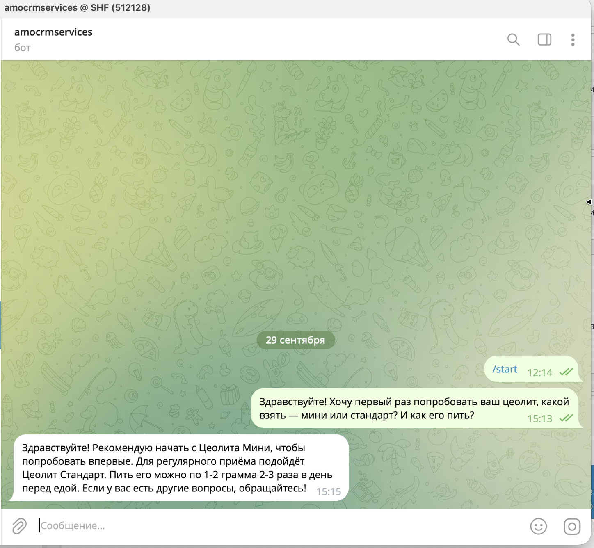
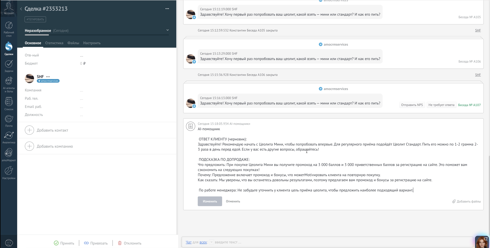

# AI-помощник менеджера в amoCRM

Прототип сервиса. Сервис получает обращение клиента из чата amoCRM, сверяет его с короткой базой знаний и возвращает менеджеру два блока:

1. **Вежливый ответ клиенту** (черновик).
2. **Подсказку по допродаже**: что предложить, почему это уместно и какой фразой сказать. К ней добавляется короткая рекомендация по работе менеджера в этом диалоге.

Подсказка появляется примечанием в сделке. Клиент её не видит: менеджер сам решает, что отправить.

База знаний собрана по открытым данным магазина O-Complex (продукты на основе цеолита): каталог с ценами, доставка, оплата, бонусная программа и типовые связки для допродажи.

## Как это выглядит

Клиент пишет в Telegram, сообщение попадает в чат сделки amoCRM:



Через несколько секунд в сделке появляется примечание «AI-помощник» с черновиком ответа, подсказкой по допродаже и советом менеджеру:



> На скриншоте видно известную проблему локальной модели на 7B: в ответе появилась дозировка («1–2 грамма 2–3 раза в день»), которой нет в базе знаний. Сама база прямо запрещает придумывать схемы приёма. Поэтому ответ остаётся черновиком, а не уходит клиенту автоматически.

Что сделано для надёжности:

- **Вебхук отвечает сразу**, генерация идёт в очереди: amoCRM ждёт быстрый 2xx. Секрет в URL проверяется через `hash_equals`.
- **Одна подсказка на пачку сообщений.** Задача уникальна для сделки и ставится с задержкой 5 секунд. Если клиент дописал что-то, пока модель генерировала ответ, устаревшая подсказка отбрасывается.
- **Без дублей.** Если вебхук пришёл повторно, а подсказка на это сообщение уже есть, модель не вызывается.
- **Если менеджер уже ответил,** подсказка не создаётся. Факт ответа берётся из `GET /api/v4/events`: вебхук на исходящие сообщения amoCRM не присылает.
- **Структурированный вывод.** JSON-схема передаётся в параметр `format` Ollama. Если модель переходит на иероглифы (у Qwen такое бывает), запрос повторяется один раз.
- **Защита от подмены инструкций.** Диалог передаётся модели внутри тега `<dialog>` как данные, теги и переводы строк в тексте клиента экранируются.

## Стек

| Что | Чем |
|---|---|
| Язык и фреймворк | PHP 8.3+, Laravel 13 |
| LLM | [Ollama](https://ollama.com) локально, модель `qwen2.5:7b` |
| Работа с базой знаний | весь файл базы знаний в системном промпте (около 60 строк, RAG не нужен) |
| CRM | amoCRM: вебхук `message[add]`, API v4 (примечания, события) |
| Канал клиента | Telegram через встроенную интеграцию amoCRM |
| База данных | SQLite |
| Очередь | Laravel Queue, драйвер `database` |
| Тесты | PHPUnit 12, 19 тестов (`Http::fake` вместо amoCRM и Ollama) |
| Стиль кода | Laravel Pint |

Основные файлы:

- `app/Http/Controllers/AmoWebhookController.php` — приём вебхука;
- `app/Jobs/GenerateLeadSuggestion.php` — генерация подсказки и отправка в сделку;
- `app/Services/SalesAssistant.php` — промпт, JSON-схема, запрос к Ollama;
- `app/Services/SalesSuggestion.php` — ответ модели и текст примечания;
- `app/Services/AmoCrmClient.php` — примечания и события amoCRM;
- `app/Console/Commands/SuggestReply.php` — консольная команда для проверки без amoCRM;
- `resources/prompts/knowledge_base.md` — база знаний.

## Какие ИИ-инструменты помогли собрать

- **[Claude Code](https://claude.com/claude-code)** — основной инструмент. Работал в терминале как агент: по ТЗ спроектировал архитектуру, написал контроллер, задачу, сервисы, миграцию и тесты, прогонял тесты и правил код по их результатам, составил промпт и базу знаний, вёл ADR и этот README. Когда проверка на живом аккаунте показала, что вебхук на ответ менеджера не приходит, определение ответа переделали на API событий.
- **[Laravel Boost](https://laravel.com/docs/ai)** — пакет, который даёт агенту правила и навыки под конкретную версию Laravel (лучшие практики, тесты, очереди). С ним Claude Code писал код в стиле Laravel 13, а не по устаревшим примерам.
- **Ollama + Qwen 2.5 7B** — модель, на которой работает сам сервис. Она запускается локально, данные клиентов не уходят во внешние API, платить за токены не нужно.

## Запуск

Нужны PHP 8.3+, Composer и [Ollama](https://ollama.com).

```sh
composer install
cp .env.example .env
php artisan key:generate
touch database/database.sqlite
php artisan migrate

ollama pull qwen2.5:7b
```

### Подключение к amoCRM

1. Заполните в `.env`:

   ```dotenv
   AMOCRM_BASE_URL=https://yoursubdomain.amocrm.ru
   AMOCRM_ACCESS_TOKEN=...        # токен интеграции amoCRM
   AMOCRM_WEBHOOK_SECRET=...      # любая длинная случайная строка
   ```

   Необязательные параметры: `OLLAMA_BASE_URL`, `OLLAMA_MODEL`, `OLLAMA_TIMEOUT`, `AMOCRM_HISTORY_LIMIT` (по умолчанию 20 сообщений), `AMOCRM_SUGGESTION_DELAY` (по умолчанию 5 секунд).

2. Запустите сервер и обработчик очереди:

   ```sh
   php artisan serve
   php artisan queue:work
   ```

3. Сделайте сервер доступным из интернета (например, через туннель) и добавьте в amoCRM вебхук на входящие сообщения чата с адресом:

   ```
   https://<ваш-домен>/webhooks/amocrm/<AMOCRM_WEBHOOK_SECRET>
   ```


## Ограничения

Прототип проверен на живом аккаунте amoCRM, но к промышленной эксплуатации не готов:

- **Модель придумывает факты.** `qwen2.5:7b` иногда нарушает правила промпта: называет дозировку или трек-номер, которых нет в базе. Цифры в ответе код не проверяет. Поэтому ответ — только черновик для менеджера.
- **Модель не видит текст ответов менеджера.** amoCRM не присылает вебхук на исходящие сообщения, а в API событий есть только сам факт ответа, без текста. Совет «по работе менеджера» строится по сообщениям клиента и по тому, ответил ли менеджер.
- **Флаг «ответа нет в базе знаний»** модель ставит сама и может ошибаться.
- **Одна очередь, один воркер.** `retry_after` очереди (90 с) меньше таймаута задачи (240 с). При нескольких воркерах медленная генерация может запуститься дважды.
- **База знаний целиком в промпте.** Для 60 строк этого достаточно. Если база вырастет, понадобится поиск по эмбеддингам (RAG).
